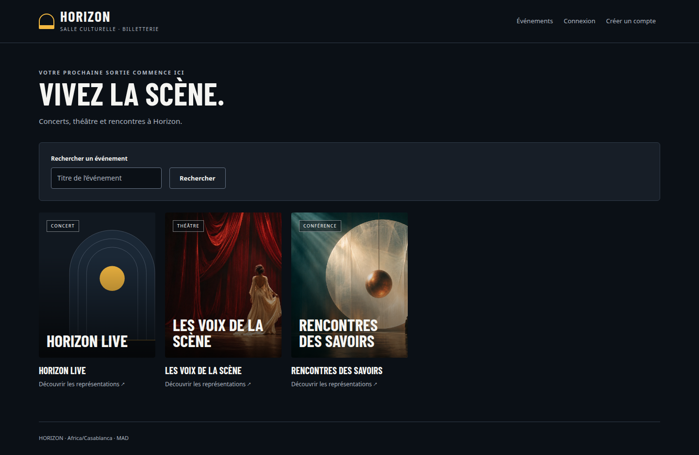
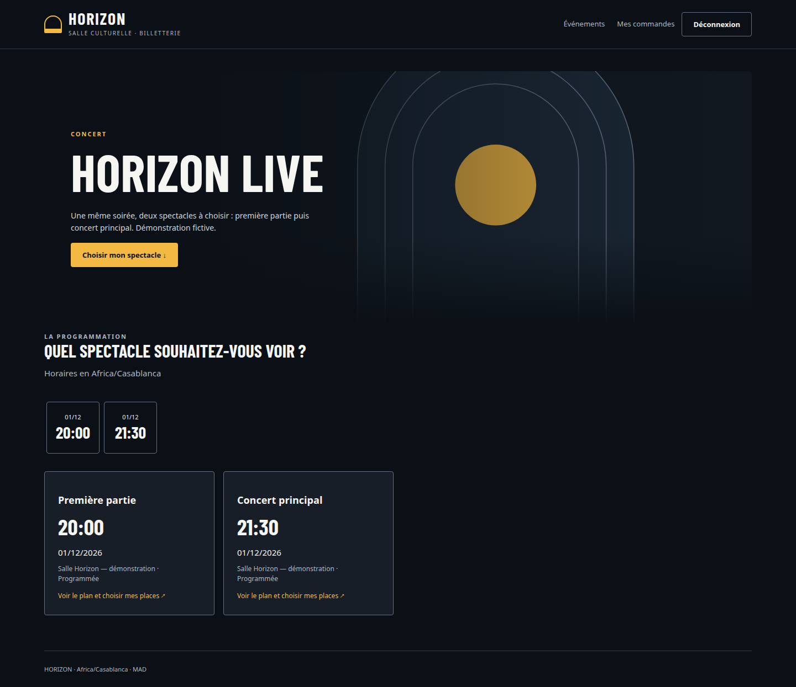
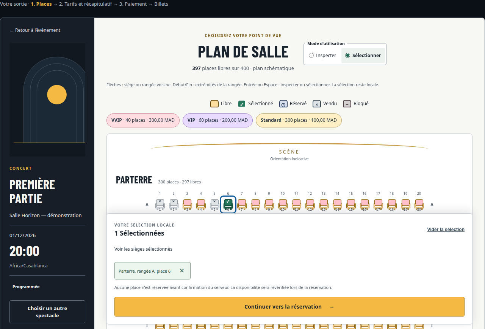
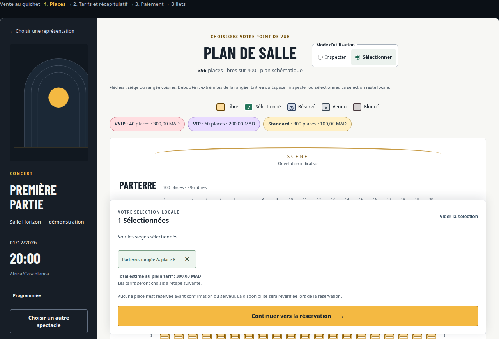
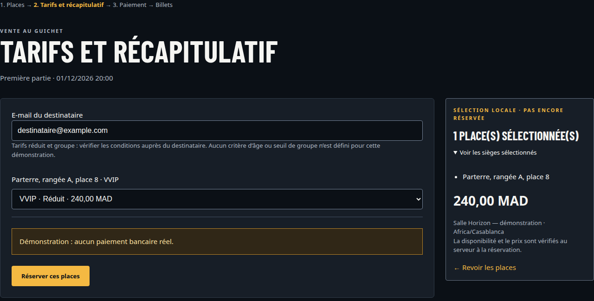
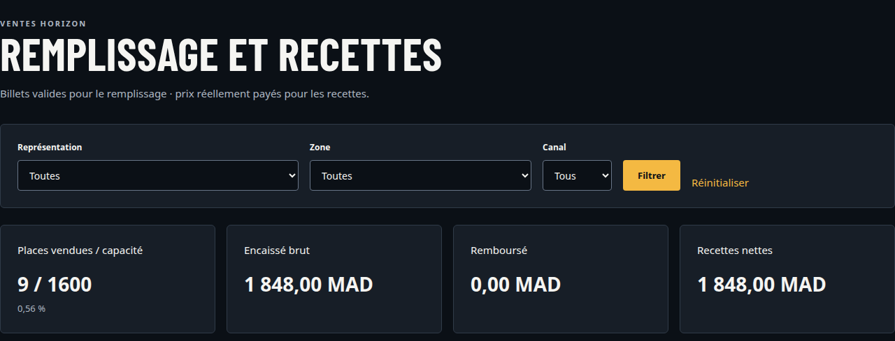
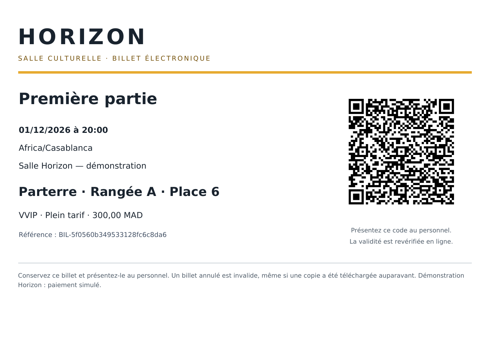

# Horizon

## Présentation

Horizon est une billetterie de salle de spectacle : les clients réservent leurs
places en ligne et les guichetiers vendent sur **le même inventaire**, sans double
vente. Les administrateurs organisent les événements et leurs spectacles,
définissent les prix et suivent le remplissage et les recettes.



*Le catalogue public, avec les événements fictifs fournis au premier démarrage.*

**Stack :** Symfony 7.4, PHP 8.3, Doctrine ORM, MySQL 8 et Docker Compose.

## Démarrage rapide

Avec Git, Docker et Docker Compose v2 installés, cloner le dépôt :

```sh
git clone https://github.com/abdelhak-kadir/Billetterie-Platform.git
cd Billetterie-Platform
docker compose up --build -d --wait
```

Ouvrir **[http://localhost:8080](http://localhost:8080)**. Le premier démarrage
installe les dépendances, applique les migrations et prépare la base, les données
fictives et les trois comptes de démonstration ; les redémarrages les conservent.
Aucune configuration Google n'est nécessaire. La durée du premier téléchargement
dépend de la connexion ; `docker compose up` permet aussi de suivre les logs au
premier plan.

Voir [INSTALL.md](INSTALL.md) pour les [prérequis](INSTALL.md#prérequis),
le [changement de port](INSTALL.md#installation-sur-un-clone-neuf),
le [dépannage](INSTALL.md#arrêt-et-dépannage) et le
[rechargement manuel des données](INSTALL.md#rechargement-manuel-des-données).

## Démonstration en deux minutes

| Rôle | Compte fictif | Espace |
| --- | --- | --- |
| Client | `client@example.com` | [Mes commandes](http://localhost:8080/compte) |
| Guichetier | `guichet@example.com` | [Guichet](http://localhost:8080/guichet) |
| Administrateur | `admin@example.com` | [Administration](http://localhost:8080/admin) |

Les **[mots de passe de démonstration sont dans INSTALL.md](INSTALL.md#comptes-de-démonstration)**.
Utiliser des profils de navigateur distincts pour comparer les trois espaces.

1. Se connecter comme client. Dans le catalogue, rechercher **Horizon Live**,
   puis choisir **Première partie**, le **1er décembre 2026 à 20 h (R1)**.
2. Sélectionner **Parterre / A / 5**, libre sur une installation neuve. Continuer,
   garder le plein tarif **VVIP à 300 MAD**, puis cliquer sur **Réserver ces places**
   et **Simuler un paiement réussi**.
3. Depuis la commande payée, ouvrir **Voir mon billet**, puis
   **Télécharger le billet PDF** : le billet contient son QR code.
4. Comme guichetier, ouvrir le même spectacle : **A5 est vendue et non
   sélectionnable**. Elle reste libre pour **Concert principal**, le **même soir à 21 h 30 (R2)**.
5. Comme administrateur, ouvrir **Mes événements → Horizon Live → Première partie**, puis **Ventes et billets**. Le plan confirme la place vendue ;
   **Remplissage et recettes** affiche le bilan.

Le jeu neuf contient **400 places, 3 événements, 4 représentations, 1 600
inventaires, 48 tarifs et 6 billets fictifs vendus**. A1 est déjà vendue sur R1.
Après un premier essai, choisir une autre place libre : un redémarrage ne remet
pas A5 en vente. Les dates des fixtures sont fixes ; effectuer l'achat avant le
début du spectacle. Pour créer un autre programme avec Standard/VIP/VVIP,
suivre le [formulaire guidé des événements](docs/EVENEMENTS.md).
Sur une base ancienne, ce programme est ajouté une seule fois ; les anciennes
ventes restent conservées. Voir [la mise à jour du jeu de démonstration](docs/DEMO_SPECTACLES.md).

## Captures d'écran

Toutes les vues ci-dessous proviennent d'une installation isolée et de comptes
fictifs. Elles montrent des ventes simulées ; aucun compte réel ni lien externe
privé n'est publié.

### Spectacles d’un même concert



*Le client choisit le spectacle, puis ses places et leur catégorie.*

### Plan de salle client



*La sélection précède la réservation ; le serveur vérifie à nouveau la disponibilité.*

### Guichet



*Le guichet partage les disponibilités du client pour le même spectacle.*



*Le guichetier choisit le tarif autorisé avant le paiement simulé.*

### Remplissage et recettes



*Les indicateurs distinguent capacité, places vendues, recettes et remboursements.*

### Billet PDF



*Exemple issu d'un achat simulé dans l'installation jetable ; son QR vise cette démo locale.*

## Fonctionnalités et documentation

Les réservations temporaires expirent automatiquement. Les transactions, verrous
MySQL et contraintes SQL empêchent deux ventes concurrentes de la même place.
Clients, guichetiers et administrateurs disposent de droits distincts ; les
commandes donnent accès à des billets PDF privés avec QR signé. L'administration
gère aussi les annulations, remboursements simulés et rapports de vente.

**Le paiement et les remboursements sont simulés**, sans mouvement bancaire.
La synchronisation Google Sheets utilise une file et un worker avec reprise ;
elle est **facultative pour lancer la démo locale** et nécessite une configuration
Google autorisée. La [validation finale](docs/VALIDATION_FINALE.md) distingue les
contrôles locaux, CI et Google réels ; le QR ne marque pas une entrée à usage unique.

- [Installation et dépannage](INSTALL.md).
- [Modèle de données](docs/MODELE.md) et [décisions métier](docs/DECISIONS.md).
- [Tests, concurrence MySQL et suite Demo Fixtures](tests/README.md).
- [Gestion des événements](docs/EVENEMENTS.md), [Google Sheets](docs/GOOGLE_SHEETS.md)
  et [index de la documentation](docs/README.md).

Pour préparer les bases de tests jetables et lancer les suites après démarrage :

```sh
./bin/test-docker
```
