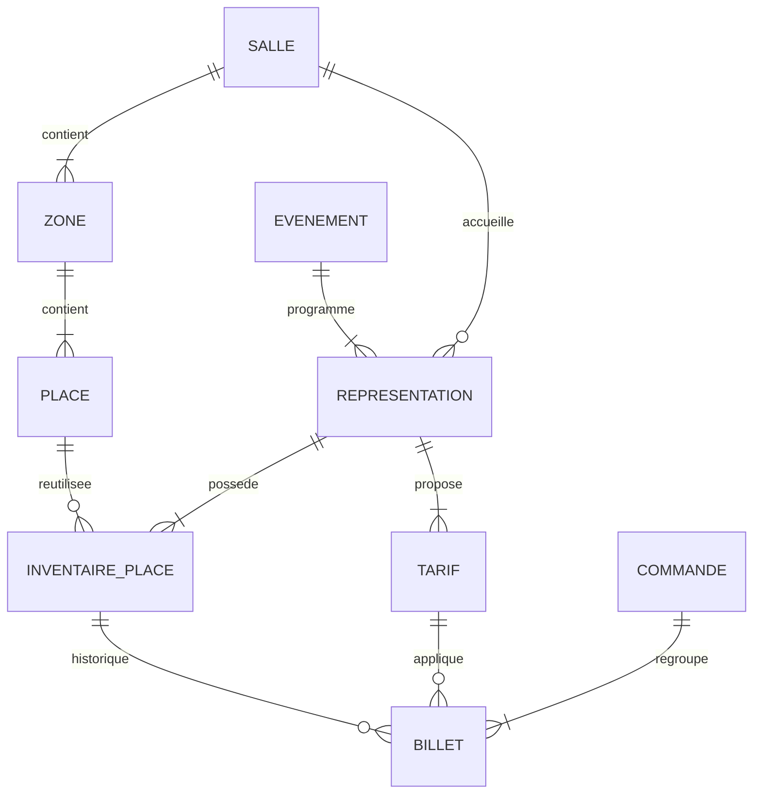

# Modèle de données — Niveau 1

Proposition initiale du 10 novembre 2026. Ce document décrit le schéma à implémenter ; aucune migration n'a encore été exécutée.

| Entité | Champs principaux et contraintes |
| --- | --- |
| Salle | `id`, `nom` ; une salle fixe de 400 places pour la démonstration |
| Zone | `id`, `salle_id`, `nom` ; unicité `(salle_id, nom)` |
| Place | `id`, `zone_id`, `rangee`, `numero` ; unicité `(zone_id, rangee, numero)` |
| Événement | `id`, `titre`, `description`, `type` : concert, théâtre, conférence |
| Représentation | `id`, `evenement_id`, `salle_id`, `debut`, `statut` : programmée, annulée, terminée |
| InventairePlace | `id`, `representation_id`, `place_id`, `statut` : disponible, réservée, vendue ; `reservation_expire_a` et `commande_reservation_id` nullable ; **contrainte unique SQL `(representation_id, place_id)`** |
| Tarif | `id`, `representation_id`, `libelle`, `prix_centimes`, `actif` ; unicité `(representation_id, libelle)` |
| Commande | `id`, `reference` unique, `email_client`, `canal` : en ligne ou guichet ; `statut` : en attente, payée, expirée, annulée, remboursée ; `cree_a`, `paye_a` nullable |
| Billet | `id`, `reference` unique, `commande_id`, `inventaire_place_id`, `tarif_id`, `prix_paye_centimes`, `statut` : valide, annulé, remboursé ; `emis_a` |

## Réutilisation du plan et disponibilité

La place physique appartient à une zone, elle-même liée à la salle. Elle n'appartient pas à un événement. Chaque nouvelle représentation reçoit une ligne d'inventaire par place de la salle, dans une transaction. Le nombre de places est dérivé du plan et ne doit pas être saisi séparément.

Exemple du prochain jalon : la place `Parterre / A / 1` a le même `place_id` pour les représentations R1 et R2. Son inventaire `(R1, place)` peut être vendu tandis que `(R2, place)` reste disponible. Les deux lignes sont indépendantes.

Les associations doivent respecter la salle : une place inventoriée appartient à la salle de la représentation. Le tarif d'un billet appartient à la même représentation que son inventaire. Ces invariants seront vérifiés par les services métier et couverts par des tests.

## Prix et historique

Tous les montants sont des entiers en centimes de MAD. Le prix payé est copié dans le billet lors de la vente ; modifier un tarif n'affecte pas les ventes passées. Une invitation vaut zéro. La recette correspond aux billets valides de commandes payées ; les remboursements sont présentés séparément.

Un inventaire peut avoir plusieurs billets historiques après annulation et revente, mais au plus un billet valide. La contrainte unique sur l'inventaire empêche les doublons de lignes, **elle ne suffit pas à empêcher deux ventes concurrentes**. Au Niveau 2, l'achat verrouillera la ligne d'inventaire dans une transaction MySQL avant de vérifier son état, créer le billet et passer la place à vendue.

## Première tranche et démonstration prévues

1. Migrer le schéma sur MySQL 8 avec InnoDB et clés étrangères.
2. Charger une salle de 400 places : Parterre, 15 rangées de 20 places ; Balcon, 5 rangées de 20 places.
3. Charger un événement avec deux représentations et 400 lignes d'inventaire distinctes par représentation.
4. Fournir un back-office permettant de lister, créer et modifier les événements et représentations, consulter le plan, les tarifs, les commandes et les billets. L'ajout d'une représentation génère son inventaire complet.
5. Étendre les fixtures à trois événements de types différents, au moins quatre représentations, plusieurs tarifs et des ventes fictives en ligne et au guichet.
6. Vérifier sur MySQL que la vente de A1 pour R1 laisse A1 disponible pour R2 et que l'insertion d'un second inventaire pour `(R1, A1)` échoue.

Les suppressions des objets liés à des ventes seront refusées ; les annulations conservent l'historique. Le plan est figé une fois utilisé. Le back-office local du Niveau 1 n'est pas destiné à une exposition publique avant l'ajout des comptes et rôles.
