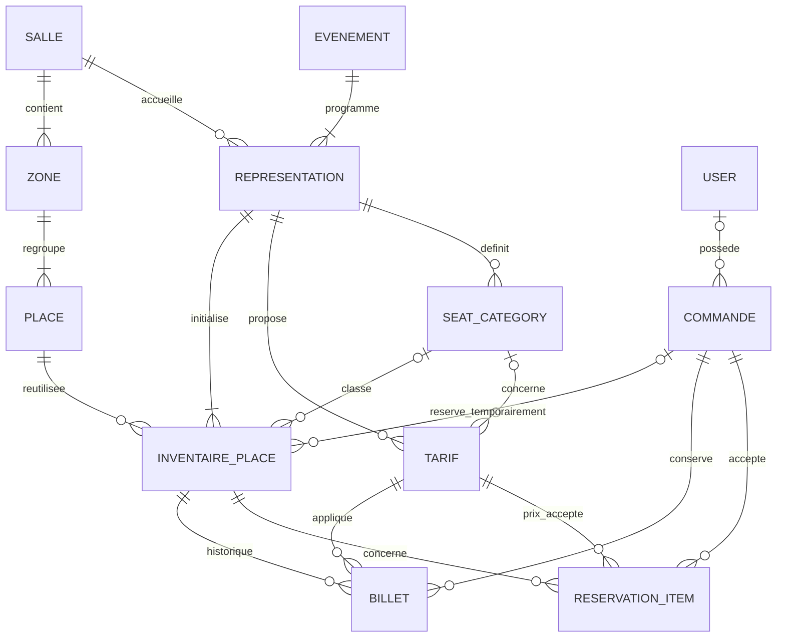
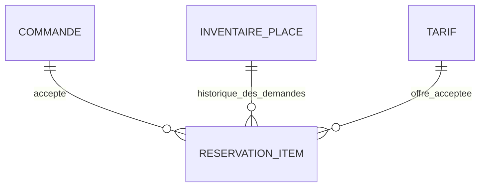

# Modèle métier Horizon

État du 15 novembre 2026 : modèle implémenté avec Doctrine et six migrations
MySQL. Les niveaux 1 à 3 comprennent le plan de salle, les inventaires par
représentation, les réservations temporaires, les ventes et remboursements
simulés, les comptes, les billets PDF/QR et les indicateurs.

`ReservationItem` conserve le prix accepté à la réservation. `User` porte
l’identité et le rôle ; `Commande.owner_id` est nullable pour conserver les
ventes historiques sans les attribuer par simple égalité d’e-mail. Les nouvelles
commandes concernent une seule représentation ; les anciennes commandes
multi-représentations restent prises en charge pour leur annulation.

Le plan initial est fixe, les montants sont stockés en centimes de MAD et les
inventaires sont indépendants d’une représentation à l’autre. Les décisions
initiales du 11 novembre sont conservées dans [DECISIONS.md](DECISIONS.md) ;
D11–D16 précisent les règles effectivement retenues. Voir [SPRINT2.md](SPRINT2.md)
pour les transactions et [NIVEAU3.md](NIVEAU3.md) pour les droits et parcours.

## Sources et périmètre

Sources originales lues : `sujet-1-billetterie.md` et `00-demarche.md`, disponibles
dans les documents de cadrage du challenge (non copiés dans ce dépôt).
Le sujet exige une salle de 400 places numérotées regroupées en zones ou
catégories, un plan réutilisable, plusieurs événements avec une ou plusieurs
représentations, plusieurs tarifs, la vente en ligne et au guichet, le suivi des
ventes, recettes et remplissage. La démarche impose Symfony 7.4, MySQL 8,
Doctrine ORM et migrations, et demande de documenter les hypothèses.

Les migrations, les fixtures et l’administration réalisent le niveau 1 ; le
service transactionnel et ses tests réalisent le niveau 2 ; les comptes, le plan
partagé, les PDF/QR et les rapports réalisent le niveau 3. Le bilan de livraison
à jour est centralisé dans le [README](../README.md#fonctionnalités-et-documentation).

La répartition Parterre 300 / Balcon 100 est une hypothèse de démonstration,
pas une exigence supplémentaire du sujet.

## Objets, responsabilités et champs principaux

Tous les objets ont une clé primaire `id`. Les clés étrangères ci-dessous sont
obligatoires sauf mention « nullable ». Les champs décrivent le schéma Doctrine/MySQL livré.

| Objet | Responsabilité et champs |
| --- | --- |
| Salle | Décrit le lieu et son plan réutilisable : `nom`. La capacité initiale de 400 est dérivée des places, pas d'un compteur modifiable indépendamment. |
| Zone | Regroupe les places d'une salle : `salle_id`, `nom`. |
| Place | Identité physique stable : `zone_id`, `rangee`, `numero` positif. Ne porte aucun état de vente. Le libellé public inclut zone, rangée et numéro. |
| Evenement | Décrit le programme : `titre`, `description`, `type` (concert, théâtre, conférence), `image_filename` nullable pour un visuel personnalisé. L’image reste un fichier local ; seul son nom généré est stocké en base. |
| Representation | Spectacle réservable d'un événement dans une salle : `evenement_id`, `salle_id`, `nom` nullable (repli sur le titre de l'événement), `debut`, `statut` (programmée, annulée, terminée). |
| SeatCategory | Catégorie de place propre à une représentation : `representation_id`, `code` (standard, vip, vvip), `nom`. Distincte du type commercial d'un tarif. |
| InventairePlace | Disponibilité d'une place pour une représentation : `representation_id`, `place_id`, `seat_category_id` nullable pour l'historique, `statut` (disponible, réservée, vendue, bloquée), `commande_reservation_id` nullable, `reservation_expire_a` nullable. « Bloquée » empêche une nouvelle vente : représentation annulée ou place annulée après fermeture des ventes. |
| Tarif | Offre de prix pour une représentation : `representation_id`, `seat_category_id` nullable pour l'historique, `libelle`, `categorie` (plein, réduit, groupe, invitation), `prix_centimes` entier non négatif, `actif` booléen. Plusieurs offres d'une même catégorie sont possibles. |
| User | Compte avec e-mail unique, hash de mot de passe et rôle client, guichetier ou administrateur. |
| ReservationItem | Ligne acceptée : commande, inventaire, tarif et prix en centimes figé à la réservation. |
| Commande | Regroupe une opération d'achat : `reference`, `email_client`, `canal` (en ligne, guichet), `statut` (en attente, payée, échouée, expirée, annulée), `cree_a`, `paye_a` nullable. Son état de remboursement est calculé depuis ses billets, séparément du paiement. |
| Billet | Trace immuable d'une place attribuée après achat confirmé : `reference`, `commande_id`, `inventaire_place_id`, `tarif_id`, `prix_paye_centimes` entier non négatif, `statut` (valide, annulé), `emis_a`, `annule_a` nullable ; `statut_remboursement` (sans objet, à rembourser, remboursé), `montant_rembourse_centimes` entier non négatif, `rembourse_a` nullable. |
| SheetsSyncJob | File technique d’export : référence de billet unique, projection JSON sans identité client, révision, état d’envoi, tentatives, prochaine reprise et destination synchronisée. Aucun appel Google dans la transaction métier. |

Les dates sont stockées en UTC et affichées dans `Africa/Casablanca` (D10).
Le prix payé ne change jamais après émission, même lors d'un remboursement.
Les champs de remboursement décrivent un remboursement intégral par billet ;
les remboursements partiels d'un même billet ne sont pas prévus (hypothèse D06).
La file Sheets est reliée au billet par sa référence naturelle, sans clé
étrangère. Elle conserve une projection et ses révisions ; une vente et sa
demande d’export sont validées dans la même transaction. Voir
[GOOGLE_SHEETS.md](GOOGLE_SHEETS.md) pour les reprises et la gestion des lignes.
Le diagramme ci-dessous représente les associations métier, hors file technique.

## Associations et cardinalités

Une Zone appartient à une seule Salle ; une Place à une seule Zone. Une Salle
configurée possède au moins une Zone, chacune au moins une Place. Un Evenement
possède une ou plusieurs Representations ; une Representation appartient à un
seul Evenement et une seule Salle. Ces minima sont des invariants applicatifs
à la validation du plan ou du programme, pas des garanties d'une simple clé étrangère.

Chaque Representation reçoit exactement les 400 lignes d'InventairePlace du
plan initial ; chaque ligne lie une seule Representation à une seule Place.
Une Place peut être réutilisée par zéro à plusieurs représentations.
Une Representation possède zéro à plusieurs Tarifs pendant sa préparation,
mais au moins un tarif actif pour ouvrir la vente.

Une Commande possède zéro à plusieurs Billets : zéro avant confirmation, au
moins un après achat confirmé. Une ligne d'inventaire peut être réservée par
zéro ou une Commande ; une Commande peut réserver plusieurs lignes. Un Billet
appartient exactement à une Commande, une ligne d'InventairePlace et un Tarif.
Un Tarif et un InventairePlace peuvent avoir zéro à plusieurs Billets historiques.
Le diagramme ne représente pas la limite conditionnelle d'un seul billet valide.

## Contraintes SQL implémentées

- Clés étrangères InnoDB sur toutes les associations ; suppression `RESTRICT`
  pour préserver les objets référencés, sans cascade destructrice des ventes.
- Unicité `(salle_id, nom)` pour Zone, `(zone_id, rangee, numero)` pour Place,
  `(representation_id, place_id)` pour InventairePlace et
  `(representation_id, libelle)` pour Tarif ; `reference` unique pour chaque
  Commande et chaque Billet.
- Champs requis `NOT NULL`, valeurs de statuts/canaux/catégories contrôlées,
  numéro strictement positif ; montants entiers avec contrôles de non-négativité
  et `montant_rembourse_centimes <= prix_paye_centimes`.
- Réservation : propriétaire et échéance obligatoires uniquement à l'état
  réservée, tous deux nuls dans les autres états (contrôle de cohérence).
- Pour garantir au plus un billet valide par inventaire tout en gardant
  l'historique : colonne technique générée nullable `inventaire_valide_id`,
  égale à `inventaire_place_id` si le billet est valide, sinon `NULL`, puis
  index UNIQUE sur cette colonne. MySQL permet plusieurs valeurs NULL dans cet
  index. Cette contrainte est livrée dans la migration initiale et testée sur MySQL 8.
  Un UNIQUE direct sur `Billet.inventaire_place_id` interdirait la revente.

## Invariants applicatifs et transactionnels

- Une place inventoriée appartient à la salle de la représentation, via sa Zone.
  Le Tarif du Billet concerne exactement cette même représentation.
- Pour les nouveaux spectacles guidés, le tarif doit aussi concerner la
  catégorie du siège. Les anciens inventaires et tarifs sans catégorie restent
  compatibles entre eux. La classification d'une place est fixée lors de sa
  création ; les prix acceptés restent historisés dans les lignes de réservation.
- La création d'une représentation initialise atomiquement son inventaire
  complet à partir des 400 places physiques existantes, sans recopier ces places.
  Aucun inventaire partiel n'est ouvert à la vente. Une relance ne crée pas de doublons.
- Le plan utilisé n'est plus modifiable ; une configuration alternative future
  sera versionnée et ne réaffectera jamais les inventaires historiques (D01).
- Vente autorisée seulement pour une représentation programmée non commencée,
  un tarif actif et une place disponible ou réservée par la commande courante
  avant échéance. Ces conditions temporelles sont des hypothèses de mise en œuvre, pas des
  règles commerciales précisées par le sujet.
- Réserver, confirmer, expirer ou annuler s'effectue dans une
  transaction avec verrouillage des lignes d'inventaire concernées, dans un ordre
  stable. L'annulation de représentation et les achats sérialisent aussi
  le contrôle de son statut, avec le même ordre de verrouillage.
- La confirmation vérifie à nouveau disponibilité, propriétaire, échéance,
  tarif et autorisations, crée les billets, copie le prix accepté et marque
  l'inventaire vendu dans une seule transaction. Les confirmations répétées
  d'une commande déjà payée ne créent pas de nouveaux billets.
- L'unicité de l'inventaire empêche deux lignes `(R1, A1)` ; elle ne protège pas
  deux achats simultanés sur la même ligne. Verrous, contrôles et index
  conditionnel sur le billet se complètent. Leur complémentarité est vérifiée par les tests de concurrence à deux processus.

## Statuts et transitions du niveau 2

| Objet | Transitions et effets |
| --- | --- |
| Representation | `terminée` est un état prévu sans transition automatique ; programmée → annulée interdit toute nouvelle vente et bloque son inventaire. Pas de réactivation prévue. |
| InventairePlace | disponible → réservée après validation du POST ; réservée → vendue après confirmation ; réservée → disponible après échec, expiration ou abandon ; vendue → disponible après annulation du billet si la représentation reste vendable ; tout état → bloquée si la représentation est annulée. La fin normale ne libère pas les places vendues. |
| Commande | en attente → payée après confirmation de tous ses achats ; en attente → échouée, expirée ou annulée libère ses seules réservations. Une nouvelle tentative après état terminal crée une nouvelle commande. payée → annulée seulement si tous ses billets sont annulés ; une annulation partielle laisse la commande payée et conserve ses autres billets valides. |
| Billet | créé valide uniquement lors de la confirmation ; valide → annulé retire définitivement le droit d'accès. Aucun retour à valide : une revente crée un nouveau billet et conserve l'ancien. |
| Remboursement du billet | sans objet tant que valide ; après annulation, à rembourser si prix payé positif, sinon sans objet ; à rembourser → remboursé uniquement sur confirmation effective du remboursement intégral. |

Une invitation à zéro peut être confirmée sans débit bancaire : la commande
payée signifie achat confirmé, y compris gratuit. Le sujet ne fixe ni délai de
réservation, ni prestataire, ni conditions de remboursement volontaire : D05–D07
explicitent les hypothèses et points à valider. Une notification de paiement
tardive après expiration ne doit jamais attribuer une place déjà réaffectée ;
son éventuelle régularisation financière sera traitée sans créer de billet concurrent.

L'annulation d'une représentation annule ses billets, libère les réservations
concernées puis bloque ses inventaires. Les billets des autres représentations
d'une commande payée restent inchangés. Une commande en attente touchée est, par hypothèse, annulée
entièrement et toutes ses réservations restantes sont libérées. Une commande
payée conserve ses prix et ses billets, même après annulation ou remboursement.
Le remboursement d'une commande est « aucun », « à rembourser », « partiel » ou
« total » par agrégation des montants dus et confirmés des billets concernés ;
un remboursement de certains billets n'est jamais présenté comme celui de toute
la commande. « Total » signifie que tous les montants positifs de la commande
ont été remboursés ; « partiel » signifie qu'une somme positive inférieure au
total payé a été remboursée, même si tous les billets annulés sont déjà remboursés.
Le solde encore dû est affiché indépendamment de cette synthèse.

Au guichet, la réservation puis la confirmation utilisent le même service que
le parcours client ; chaque opération est atomique et revalide la disponibilité.

Pour suivre les finances, distinguer ventes brutes (somme des prix payés des
billets émis), remboursements confirmés et recette nette (brut moins remboursements).
Les montants encore à rembourser sont présentés séparément. Le remplissage
compte les billets valides par représentation/zone ; les réservations temporaires
sont un indicateur distinct. Annuler un billet ne fait pas disparaître l'encaissement.

## Scénarios de référence et validation

Ces scénarios du cadrage initial sont désormais couverts par les suites
`Integration` et `Functional`, dont les contraintes et verrous sont exécutés sur
MySQL. Les résultats datés sont consignés dans [SPRINTS.md](SPRINTS.md).

| Scénario | Résultat attendu et fondement |
| --- | --- |
| A1 vendue pour R1, disponible pour R2 | Même Place, deux InventairePlace distincts ; seul `(R1, A1)` devient vendu. |
| Deux inventaires `(R1, A1)` | Refus par UNIQUE `(representation_id, place_id)`. |
| Achat à 100 MAD puis tarif à 120 MAD | Billet conserve `prix_paye_centimes = 10000` ; Tarif passe à `12000`, pour les nouveaux achats. |
| Invitation | `prix_paye_centimes = 0` autorisé ; aucune dette de remboursement lors de son annulation. |
| Représentation annulée | Billets annulés conservés, prix immuables, commandes conservées, inventaires bloqués ; remboursement suivi séparément. |
| Nouvelle représentation | Création atomique de 400 inventaires, un par Place de sa Salle, sans créer 400 nouvelles places physiques. |
| Annulation puis revente d'A1 pour R1 | Ancien billet annulé reste attaché à la commande initiale ; nouveau billet rattaché à une nouvelle commande ; l'index conditionnel refuse un second billet valide. |

## Limites et hypothèses métier

La durée retenue est de 600 secondes configurables, le prix est figé à la
réservation, et les invitations sont réservées à l’administrateur. Restent à
valider avec un exploitant réel : conditions du réduit/groupe, politique de
remboursement, variantes de salle et prestataire bancaire. Aucun seuil
commercial ni paiement réel n’est ajouté implicitement.

## Extension implémentée au Sprint 2 — 12 novembre 2026

Les décisions D11–D13 et [SPRINT2.md](SPRINT2.md) précisent maintenant les cibles
Niveau 2 de ce document. La durée retenue est de 600 secondes configurables et
le prix est fixé lors de la réservation, remplaçant l'hypothèse D04 initiale.

`Commande.reservationExpireA` (nullable pour les ventes S1 historiques) conserve
l'échéance. `ReservationItem` conserve chaque ligne acceptée : clé primaire `id`,
`commande_id`, `inventaire_place_id`, `tarif_id`, `prix_centimes` non négatif.
Ces liens obligatoires ont des clés étrangères RESTRICT ; unicité
`(commande_id, inventaire_place_id)`. Le service contrôle représentation, salle,
tarif actif et prix d'invitation. Les lignes ne sont ni effacées ni réaffectées
après expiration ou annulation. Les prix actuels des tarifs n'en changent pas le contenu.

Une commande S1 peut n'avoir aucune ligne acceptée ; une nouvelle réservation
S2 en possède au moins une et concerne exactement une représentation. Les
billets restent émis seulement lors de la confirmation payée et conservent
leurs liens directs vers commande, inventaire et tarif. Leur unicité conditionnelle
et l'historique des anciennes ventes ne sont pas modifiés par cette extension.

## Projection vers Google Sheets

`SheetsSyncJob` conserve une ligne par référence de billet, avec payload métier
JSON, révision, statut, nombre d’essais, prochaine tentative et preuve d’envoi
par destination. Il n’exporte aucune identité de client. Sa création ou mise à
jour appartient à la transaction de vente/annulation. Le worker utilise un
identifiant de ligne stable et valide le succès uniquement pour la révision
envoyée. Voir [GOOGLE_SHEETS.md](GOOGLE_SHEETS.md) pour le contrat d’export.
